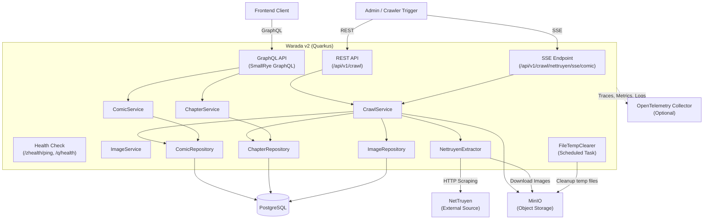
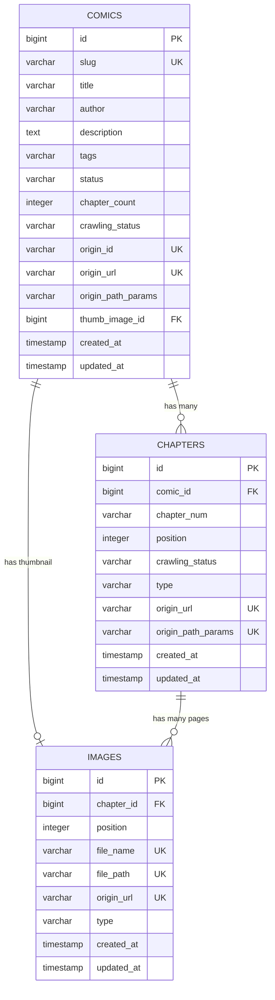

# System Design & Architecture

## Architecture Overview
**What is the high-level system structure?**



### Key Components
| Component | Responsibility |
|---|---|
| **GraphQL API** | Read-only queries for comics, chapters, images with pagination |
| **REST API** | Crawl triggers for comics and chapters from NetTruyen |
| **SSE Endpoint** | Real-time streaming of chapter crawl progress |
| **CrawlService** | Orchestrates the full crawl workflow (extract → download → persist) |
| **NettruyenExtractor** | Scrapes HTML from NetTruyen, extracts structured data and images |
| **FileTempClearer** | Scheduled job to clean up stale temporary images in MinIO |
| **Repositories** | Panache-based data access layer for PostgreSQL |

### Technology Stack
| Layer | Technology | Version |
|---|---|---|
| Framework | Quarkus | 3.28.1 |
| Language | Java | 21 |
| Build Tool | Gradle | (Wrapper included) |
| Database | PostgreSQL | 16 (Alpine) |
| Object Storage | MinIO | RELEASE.2025-01-18 |
| DB Migrations | Liquibase | (Quarkus extension) |
| API - Query | SmallRye GraphQL | (Quarkus extension) |
| API - REST | Quarkus REST (RESTEasy Reactive) | (Quarkus extension) |
| API - Docs | SmallRye OpenAPI | (Quarkus extension) |
| Observability | OpenTelemetry | (Quarkus extension) |
| Health | SmallRye Health | (Quarkus extension) |
| Scheduling | Quarkus Scheduler | (Quarkus extension) |
| Code Gen | Lombok | 1.18.42 |
| Container | Docker (native image) | UBI 9 Minimal / Micro |

## Data Models
**What data do we need to manage?**

### Entity Relationship Diagram



### Core Entities
- **Comic**: A manga/comic series with metadata (title, author, tags, description, status), origin tracking, and crawl status
- **Chapter**: Individual chapter belonging to a comic, with ordering (position) and crawl status
- **Image**: Image files stored in MinIO, linked to either a comic (as thumbnail) or a chapter (as page)

### Enums
- **CrawlStatus**: `INIT` (0000) → `STARTED` (0001) → `FINISHED` (9999)
- **ImageType**: `THUMB_IMAGE` (THUMB) | `CHAPTER_IMAGE` (CHAPTER_IMAGE)

## API Design
**How do components communicate?**

### GraphQL API (Query)
Available at `/graphql` with UI at `/q/graphql-ui` (dev mode only).

| Query | Parameters | Returns | Description |
|---|---|---|---|
| `ping` | — | `String` | Health check returning "Pong" |
| `comics` | `pageRequest: PageRequest` | `[Comic]` | Paginated list of comics |
| `comic` | `id: Long` | `Comic` | Single comic by ID |
| `detailChapterById` | `id: Long` | `ChapterDetailGql` | Chapter detail by ID |
| `detailChapterBySlug` | `slug: String` | `ChapterDetailGql` | Chapter detail by slug |
| `chapters` | `comicId: Long, pageRequest: PageRequest` | `[ChapterDetailGql]` | Paginated chapters for a comic |

### REST API (Crawl Operations)
Base path: `/api/v1/crawl`

| Method | Path | Body / Params | Response | Description |
|---|---|---|---|---|
| `POST` | `/nettruyen/comic` | `{ "slugNId": "..." }` | `200 "Success"` | Crawl a comic from NetTruyen |
| `POST` | `/nettruyen/chapter` | `{ "chapterId": 123 }` | `200 "Success"` | Crawl a single chapter |
| `GET` | `/nettruyen/sse/comic?slug-n-id=...` | Query param | SSE stream | Stream chapter crawl progress |

### Health Endpoints
| Method | Path | Description |
|---|---|---|
| `GET` | `/zhealth/ping` | Custom ping endpoint ("pong") |
| `GET` | `/q/health` | SmallRye Health (readiness + liveness) |

### PageRequest Input
```json
{
  "page": 0,
  "size": 20,
  "sortBy": "field_name",
  "sortOrder": "asc"
}
```

## Component Breakdown
**What are the major building blocks?**

### Package Structure
```
com.github.warada_v2/
├── Application.java              # Quarkus main entry point
├── commons/
│   ├── Constant.java             # Application constants
│   ├── Utils.java                # Utility methods (e.g., URL extension extraction)
│   └── enums/
│       ├── CrawlStatus.java      # INIT → STARTED → FINISHED
│       └── ImageType.java        # THUMB_IMAGE, CHAPTER_IMAGE
├── configurations/
│   ├── MinioConfig.java          # MinIO connection config mapping
│   ├── MinioClientProducer.java  # CDI producer for MinioClient
│   └── WaradaConfig.java         # App-specific config (buckets, paths, cleanup)
├── converter/
│   ├── CrawlStatusConverter.java # JPA converter for CrawlStatus enum
│   └── ImageTypeConverter.java   # JPA converter for ImageType enum
├── db_entities/
│   ├── Comic.java                # JPA entity for comics table
│   ├── Chapter.java              # JPA entity for chapters table
│   └── Image.java                # JPA entity for images table
├── exceptions/
│   ├── BusinessException.java    # Base business exception
│   ├── ConflictException.java    # 409 Conflict
│   ├── ConflictExceptionMapper.java
│   └── ResourceNotFoundException.java
├── mapper/
│   └── GlobalExceptionMapper.java # Global exception → JSON error response
├── models/
│   ├── ApiError.java             # Error response model
│   ├── ApiResponse.java          # Generic API response wrapper
│   ├── ChapterDetailGql.java     # GraphQL response DTO for chapters
│   ├── CrawlNettruyenChapterRequest.java
│   ├── CrawlNettruyenComicRequest.java
│   ├── CrawlNettruyenSSEComic.java   # SSE event payload
│   ├── ExtractedChapterDetail.java
│   ├── ExtractedChapters.java
│   ├── ExtractedComicDetail.java
│   ├── ExtractedImage.java
│   ├── ExtractedNettruyenComic.java
│   ├── ExtractedThumbImage.java
│   ├── PageRequest.java          # Pagination input
│   └── PageResponse.java         # Pagination output wrapper
├── repositories/
│   ├── ChapterRepository.java    # Interface
│   ├── ChapterRepositoryImpl.java
│   ├── ComicRepository.java      # Interface
│   ├── ComicRepositoryImpl.java
│   ├── ImageRepository.java      # Interface
│   └── ImageRepositoryImpl.java
├── resources/
│   ├── ChapterGqlResource.java   # GraphQL endpoint for chapters
│   ├── ComicGqlResource.java     # GraphQL endpoint for comics
│   ├── CrawlRestResource.java    # REST endpoint for crawl operations
│   ├── HealthCheckResource.java  # Custom health ping
│   └── ImageGqlResource.java     # GraphQL endpoint for images (stub)
├── rest/
│   └── client/
│       └── NettruyenRestService.java  # MicroProfile REST Client for NetTruyen
├── scheduler/
│   └── FileTempClearer.java      # Scheduled cleanup of temp MinIO objects
└── services/
    ├── ChapterService.java / ChapterServiceImpl.java
    ├── ComicService.java / ComicServiceImpl.java
    ├── CrawlService.java / CrawlServiceImpl.java
    ├── ImageService.java / ImageServiceImpl.java
    └── NettruyenExtractor.java / NettruyenExtractorImpl.java
```

### Third-Party Integrations
- **NetTruyen** — HTML scraping via MicroProfile REST Client + regex-based extraction
- **MinIO** — S3-compatible object storage via `io.minio:minio` Java SDK
- **OpenTelemetry Collector** — Traces, metrics, logs export (production)

## Design Decisions
**Why did we choose this approach?**

| Decision | Rationale | Alternatives Considered |
|---|---|---|
| **Quarkus** over Spring Boot | Native image support, fast startup, low memory | Spring Boot + GraalVM |
| **GraphQL** for read APIs | Flexible queries, client-driven data fetching | REST-only API |
| **REST** for crawl operations | Simple trigger endpoints, SSE support | GraphQL mutations |
| **MinIO** for image storage | S3-compatible, self-hosted, lightweight | Local filesystem, AWS S3 |
| **Liquibase** for migrations | Reliable schema versioning, Quarkus integration | Flyway |
| **HTML scraping** for extraction | No official API available from NetTruyen | N/A |
| **Panache** for ORM | Simplified repository pattern on top of Hibernate | Plain Hibernate, jOOQ |
| **SSE** for crawl streaming | Native browser support, simpler than WebSocket | WebSocket, polling |

## Non-Functional Requirements
**How should the system perform?**

- **Startup time:** < 1 second (native image), < 5 seconds (JVM mode)
- **Memory:** < 128MB RSS (native image) under normal load
- **Scalability:** Single instance design; horizontal scaling possible with shared PostgreSQL and MinIO
- **Reliability:** Liquibase ensures DB schema consistency; crawl status tracking prevents duplicate work
- **Observability:** OpenTelemetry integration for traces, metrics, and logs in production
