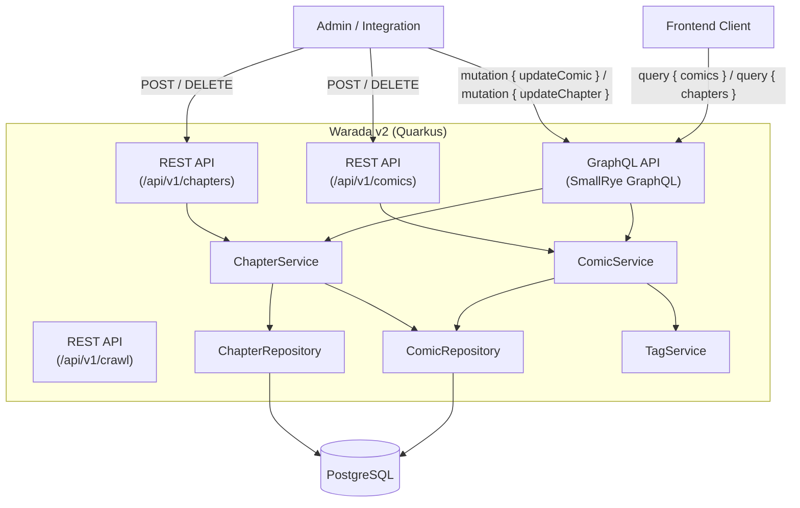

# Design: CRUD for Comic & Chapter

## Architecture Update



## API Design

### REST — Comic

| Method | Path | Request Body | Response |
|---|---|---|---|
| `POST` | `/api/v1/comics` | `CreateComicRequest` JSON | `201 Comic` JSON |
| `DELETE` | `/api/v1/comics/{id}` | — | `204 No Content` |

#### `CreateComicRequest` Schema
```json
{
  "title": "string (required)",
  "description": "string (optional)",
  "author": "string (optional)",
  "status": "string (optional, default: ongoing)",
  "slug": "string (required, unique)",
  "origin_id": "string (optional, unique)",
  "origin_url": "string (optional, unique)",
  "origin_path_params": "string (optional, unique)",
  "tags": ["string"] 
}
```

### REST — Chapter

| Method | Path | Request Body | Response |
|---|---|---|---|
| `POST` | `/api/v1/chapters` | `CreateChapterRequest` JSON | `201 ChapterDetailGql` JSON |
| `DELETE` | `/api/v1/chapters/{id}` | — | `204 No Content` |

#### `CreateChapterRequest` Schema
```json
{
  "comic_id": "long (required)",
  "chapter_number": "string (optional)",
  "type": "string (optional)",
  "position": "integer (optional)",
  "origin_url": "string (optional, unique)",
  "origin_path_params": "string (optional, unique)"
}
```

### GraphQL — Comic Mutation

```graphql
mutation {
  updateComic(id: 1, input: {
    title: "New Title"
    description: "Updated description"
    author: "Author Name"
    status: "completed"
  }) {
    id
    title
    description
    author
    status
    slug
    updatedAt
  }
}
```

### GraphQL — Chapter Mutation

```graphql
mutation {
  updateChapter(id: 10, input: {
    chapterNumber: "Chapter 10"
    type: "normal"
    position: 10
  }) {
    id
    chapterNumber
    type
    position
    crawlingStatus
    updatedAt
  }
}
```

## Error Responses

All error states use `ApiError`:
```json
{
  "processId": "uuid",
  "status": 404,
  "message": "Comic not found with id: 99",
  "timestamp": "2026-03-13T..."
}
```

| Scenario | HTTP Status |
|---|---|
| Resource not found | `404 Not Found` (`ResourceNotFoundExceptionMapper`) |
| Conflicting unique field | `409 Conflict` (`ConflictExceptionMapper`) |
| Unhandled exception | `500 Internal Server Error` (`GlobalExceptionMapper`) |

## Update Semantics
Both `updateComic` and `updateChapter` use **partial update** (PATCH-style): only non-null fields in the input are applied to the entity. This avoids accidental overwrites from omitted optional fields.
