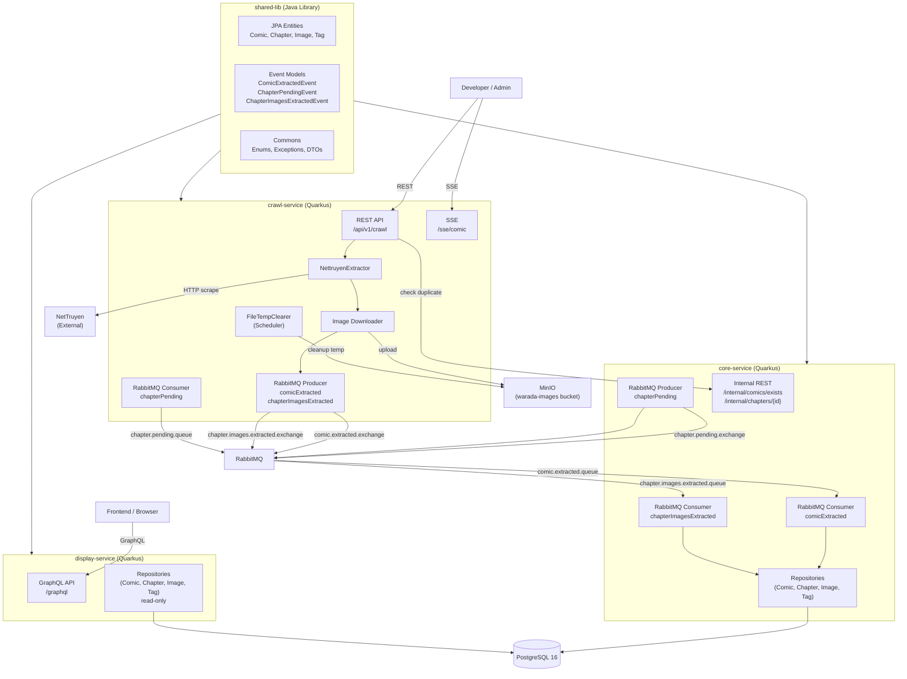

# Design: Refactor — Separate Module Architecture

## Architecture Overview



## Module Responsibilities

### `shared-lib` — Common Contracts
A plain Java library (no Quarkus plugin). All other modules depend on it.

```
shared-lib/src/main/java/com/github/warada_v2/shared/
├── entities/
│   ├── Comic.java              # JPA @Entity
│   ├── Chapter.java
│   ├── Image.java
│   └── Tag.java
├── events/
│   ├── ComicExtractedEvent.java          # record — crawl → core
│   ├── ChapterPendingEvent.java          # record — core → crawl
│   └── ChapterImagesExtractedEvent.java  # record — crawl → core
├── enums/
│   ├── CrawlStatus.java
│   └── ImageType.java
├── models/
│   ├── PageRequest.java
│   ├── PageResponse.java
│   ├── ApiError.java
│   └── ApiResponse.java
├── exceptions/
│   ├── BusinessException.java
│   ├── ConflictException.java
│   └── ResourceNotFoundException.java
└── utils/
    └── Utils.java
```

**build.gradle** for `shared-lib`:
```groovy
plugins {
    id 'java-library'
}
dependencies {
    api 'io.quarkus:quarkus-hibernate-orm-panache'   // entities
    api 'jakarta.persistence:jakarta.persistence-api'
    compileOnly 'org.projectlombok:lombok:1.18.42'
    annotationProcessor 'org.projectlombok:lombok:1.18.42'
}
```

---

### `crawl-service` — The Scraper

**Dependencies**: `shared-lib`, NetTruyen REST client, MinIO SDK, RabbitMQ (SmallRye Reactive Messaging), Quarkus REST.

**Package structure**:
```
crawl-service/src/main/java/com/github/warada_v2/crawl/
├── CrawlApplication.java
├── resources/
│   ├── CrawlRestResource.java         # POST /api/v1/crawl/nettruyen/comic
│   └── SseResource.java               # GET /sse/comic
├── services/
│   ├── CrawlService.java / CrawlServiceImpl.java
│   ├── NettruyenExtractor.java / NettruyenExtractorImpl.java
│   ├── ImageDownloadService.java      # MinIO upload logic
│   ├── CrawlProgressBroadcaster.java  # SSE event bus
│   ├── ComicCrawlProducer.java        # publishes ComicExtractedEvent
│   ├── ChapterImagesProducer.java     # publishes ChapterImagesExtractedEvent
│   └── ChapterPendingConsumer.java    # consumes ChapterPendingEvent → triggers image download
├── client/
│   └── CoreServiceClient.java         # REST client → core-service /internal/comics/exists
├── configurations/
│   ├── WaradaConfig.java
│   └── MinioBucketInitializer.java
└── scheduler/
    └── FileTempClearer.java
```

**Owns**: MinIO uploads, NetTruyen scraping, SSE streaming.  
**Does NOT own**: PostgreSQL write, entity persistence.

---

### `core-service` — The Persistence Layer

**Dependencies**: `shared-lib`, PostgreSQL (Hibernate ORM Panache, Liquibase), RabbitMQ.

**Package structure**:
```
core-service/src/main/java/com/github/warada_v2/core/
├── CoreApplication.java
├── resources/
│   └── InternalResource.java          # GET /internal/comics/exists, /internal/chapters/{id}
├── services/
│   ├── ComicPersistService.java        # saves Comic + Tags + stub Chapters
│   ├── ChapterPersistService.java      # saves Images, updates CrawlStatus
│   └── ChapterPendingProducer.java    # publishes ChapterPendingEvent after comic saved
├── consumers/
│   ├── ComicExtractedConsumer.java     # consumes ComicExtractedEvent
│   └── ChapterImagesExtractedConsumer.java
├── repositories/
│   ├── ComicRepository.java
│   ├── ChapterRepository.java
│   ├── ImageRepository.java
│   └── TagRepository.java
├── converter/
│   ├── CrawlStatusConverter.java
│   └── ImageTypeConverter.java
└── configurations/
    └── WaradaConfig.java
```

**Owns**: PostgreSQL writes, entity lifecycle, idempotency checks.  
**Exposes**: Internal REST API for dedup checks.

---

### `display-service` — The Reader

**Dependencies**: `shared-lib`, PostgreSQL (read-only connection), SmallRye GraphQL.

**Package structure**:
```
display-service/src/main/java/com/github/warada_v2/display/
├── DisplayApplication.java
├── resources/
│   ├── ComicGqlResource.java
│   ├── ChapterGqlResource.java
│   ├── ImageGqlResource.java
│   ├── TagGqlResource.java
│   └── HealthCheckResource.java
├── services/
│   ├── ComicService.java / ComicServiceImpl.java
│   ├── ChapterService.java / ChapterServiceImpl.java
│   └── TagService.java / TagServiceImpl.java
├── repositories/
│   ├── ComicRepository.java
│   ├── ChapterRepository.java
│   ├── ImageRepository.java
│   └── TagRepository.java
├── converter/
│   ├── CrawlStatusConverter.java
│   └── ImageTypeConverter.java
└── models/
    └── ChapterDetailGql.java           # display-specific GQL DTO
```

**Owns**: GraphQL schema, read queries.  
**Does NOT own**: Any write operations.

---

## RabbitMQ Event Contracts

### Exchange & Queue Topology

```
comic.extracted.exchange  (direct)
    └── comic.extracted.queue         → core-service (ComicExtractedConsumer)
    └── comic.extracted.dlq           (dead-letter on rejection)

chapter.pending.exchange  (direct)
    └── chapter.pending.queue         → crawl-service (ChapterPendingConsumer)
    └── chapter.pending.dlq

chapter.images.extracted.exchange  (direct)
    └── chapter.images.extracted.queue  → core-service (ChapterImagesExtractedConsumer)
    └── chapter.images.extracted.dlq
```

### Event Schemas

#### `ComicExtractedEvent`
Published by: `crawl-service`  
Consumed by: `core-service`

```java
public record ComicExtractedEvent(
    String slug,
    String title,
    String author,
    String description,
    String originId,
    String originUrl,
    String originPathParams,
    String status,
    List<String> tags,
    ExtractedThumbImage thumbImage,        // already uploaded to MinIO temp path
    List<ExtractedChapterDetail> chapters  // stub chapters (url + num only)
) {}
```

#### `ChapterPendingEvent`
Published by: `core-service`  
Consumed by: `crawl-service`

```java
public record ChapterPendingEvent(
    Long chapterId,
    String comicSlug,
    String chapterNum,
    String originUrl,
    String originPathParams
) {}
```

#### `ChapterImagesExtractedEvent`
Published by: `crawl-service`  
Consumed by: `core-service`

```java
public record ChapterImagesExtractedEvent(
    Long chapterId,
    String comicSlug,
    String chapterNum,
    List<ExtractedImage> images  // final MinIO permanent paths
) {}
```

---

## Crawl Flow (End-to-End)

```
User                crawl-service            RabbitMQ           core-service
 │                       │                       │                    │
 │ POST /crawl/comic      │                       │                    │
 │──────────────────────►│                       │                    │
 │                       │ GET /internal/comics/exists               │
 │                       │──────────────────────────────────────────►│
 │                       │◄──────────────────────────────────────────│
 │                       │  (404 = not exists, 200 = conflict)       │
 │                       │                       │                    │
 │                       │ scrape NetTruyen HTML  │                    │
 │                       │ upload thumb → MinIO   │                    │
 │                       │ publish ComicExtractedEvent               │
 │                       │──────────────────────►│                    │
 │                       │                       │ ComicExtractedEvent│
 │                       │                       │───────────────────►│
 │                       │                       │     persist Comic  │
 │                       │                       │     persist Tags   │
 │                       │                       │     persist Chapters (INIT)
 │                       │                       │ ChapterPendingEvent│
 │                       │                       │◄───────────────────│
 │                       │ ChapterPendingEvent    │                    │
 │                       │◄──────────────────────│                    │
 │                       │ scrape chapter images  │                    │
 │                       │ download → MinIO temp  │                    │
 │                       │ rename → permanent     │                    │
 │                       │ publish ChapterImagesExtractedEvent       │
 │                       │──────────────────────►│                    │
 │                       │                       │ChapterImagesExtracted│
 │                       │                       │───────────────────►│
 │                       │                       │  persist Images    │
 │                       │                       │  Chapter→FINISHED  │
```

**SSE Flow**: The `crawl-service` maintains an in-memory `CrawlProgressBroadcaster`. When the user connects via SSE (`GET /sse/comic?slug-n-id=...`), the broadcaster pushes chapter-level events as `ChapterPendingConsumer` processes each chapter.

---

## Gradle Multi-Module Project Structure

```
warada_v2/                         ← root project
├── settings.gradle                ← include all subprojects
├── build.gradle                   ← root conventions (java version, lombok)
├── gradle.properties
├── shared-lib/
│   ├── build.gradle
│   └── src/
├── crawl-service/
│   ├── build.gradle
│   └── src/
├── core-service/
│   ├── build.gradle
│   └── src/
├── display-service/
│   ├── build.gradle
│   └── src/
└── docs/
```

**settings.gradle** (updated):
```groovy
rootProject.name = 'warada_v2'
include 'shared-lib'
include 'crawl-service'
include 'core-service'
include 'display-service'
```

Each service's `build.gradle` adds `shared-lib` as a dependency:
```groovy
dependencies {
    implementation project(':shared-lib')
    // ... service-specific deps
}
```

---

## Configuration Per Service

### crawl-service `application.yaml`
```yaml
quarkus:
  application:
    name: warada-crawl
  http:
    port: 8081
  rabbitmq-host: ${RABBITMQ_HOST:localhost}

mp:
  messaging:
    outgoing:
      comic-extracted:
        connector: smallrye-rabbitmq
        exchange:
          name: comic.extracted.exchange
      chapter-images-extracted:
        connector: smallrye-rabbitmq
        exchange:
          name: chapter.images.extracted.exchange
    incoming:
      chapter-pending:
        connector: smallrye-rabbitmq
        queue:
          name: chapter.pending.queue
```

### core-service `application.yaml`
```yaml
quarkus:
  application:
    name: warada-core
  http:
    port: 8082
  datasource:
    db-kind: postgresql
    username: ${DB_USERNAME:postgres}
    password: ${DB_PASSWORD:postgres}
    jdbc:
      url: ${DB_URL:jdbc:postgresql://localhost:5432/postgres}
  hibernate-orm:
    packages: com.github.warada_v2.shared.entities
    database:
      generation: none
  liquibase:
    migrate-at-start: true

mp:
  messaging:
    incoming:
      comic-extracted:
        connector: smallrye-rabbitmq
        queue:
          name: comic.extracted.queue
      chapter-images-extracted:
        connector: smallrye-rabbitmq
        queue:
          name: chapter.images.extracted.queue
    outgoing:
      chapter-pending:
        connector: smallrye-rabbitmq
        exchange:
          name: chapter.pending.exchange
```

### display-service `application.yaml`
```yaml
quarkus:
  application:
    name: warada-display
  http:
    port: 8080
  datasource:
    db-kind: postgresql
    username: ${DISPLAY_DB_USERNAME:postgres}
    password: ${DISPLAY_DB_PASSWORD:postgres}
    jdbc:
      url: ${DB_URL:jdbc:postgresql://localhost:5432/postgres}
  hibernate-orm:
    packages: com.github.warada_v2.shared.entities
    database:
      generation: none
  smallrye-graphql:
    ui:
      enable: true
```

---

## Design Decisions

| Decision | Rationale | Alternative Considered |
|---|---|---|
| **Gradle multi-module** over separate repos | Single repo easier to manage during refactor; atomic commits across modules | Separate repos (more overhead) |
| **shared-lib** for entities | Avoids entity duplication; both core and display need the same JPA mappings | Duplicate entities per service |
| **core-service exposes internal REST** for dedup | Keeps dedup logic owned by core; avoids giving crawl-service DB access | crawl-service has read-only DB connection |
| **crawl-service does NOT own DB** | Clean separation: crawl = I/O (HTTP + MinIO), core = persistence | crawl-service with read-only DB (acceptable alternative) |
| **at-least-once delivery** with DLQ | Matches existing RabbitMQ config; idempotency in core-service handles retries | exactly-once (more complex, unnecessary here) |
| **display-service reads same DB** | Simplest path; avoids event-sourced read model | CQRS read model via events (future enhancement) |
| **SSE stays in crawl-service** | SSE progress is tightly coupled to the crawl process; no need to route through broker | SSE in a separate streaming service |

---

## Idempotency Strategy (core-service)

`core-service` must handle duplicate events gracefully (RabbitMQ at-least-once):

- **Comic dedup**: `INSERT INTO comics ... ON CONFLICT (slug) DO NOTHING` — or check `origin_id` unique constraint.
- **Chapter dedup**: `INSERT INTO chapters ... ON CONFLICT (origin_url) DO NOTHING`.
- **Image dedup**: `INSERT INTO images ... ON CONFLICT (file_path) DO NOTHING`.

All consumers wrap persistence in `@Transactional` and catch `ConflictException` / constraint violations without re-throwing — so the message is acknowledged and not redelivered.
